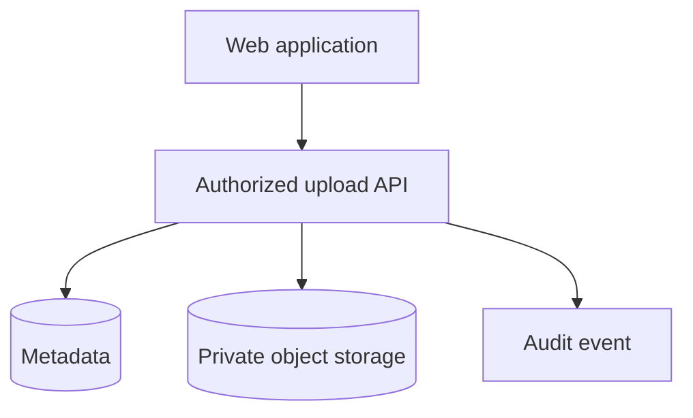

# Minimal documentation starter (adapt, do not copy blindly)

Start small and preserve existing docs. Suggested structure when a project has multiple runtimes and integrations:

```text
docs/
  00-home.md
  01-architecture.md
  02-data.md
  03-integrations.md
  04-runtime-flows.md
  05-domain.md
  decisions/        # only when ADRs are justified
```

Each note should answer one concrete question:

- `00-home`: What is this product and where should I look after months away? Link to notes, README and agent policy.
- `01-architecture`: What runs where, and what module boundaries are enforced vs conventional?
- `02-data`: Which system owns what data and how do reads/writes cross boundaries?
- `03-integrations`: How do external sources, jobs, retries, and observability work?
- `04-runtime-flows`: What are the key user and service journeys, session guards, and request-routing rules?
- `05-domain`: What non-obvious business terms/invariants must remain true?

A smaller repo may need only `00-home`, `architecture`, and one flow. A large repo may need separate domain notes or C4 views. Link to code instead of reproducing inventories. Prefer Mermaid overview and focused sequence diagrams over a single dense chart.

Example Obsidian-friendly page:

````md
# Document uploads

Uploads are private and tenant-scoped. A successful upload is not automatically a verified signature.



Invariants:
- Authorization is enforced server-side before upload and download.
- Download links are short-lived.
- Restoring files and metadata is part of disaster recovery.

Implementation: [handler](../backend/path/to/handler.go) — adjust to real files only.
````
